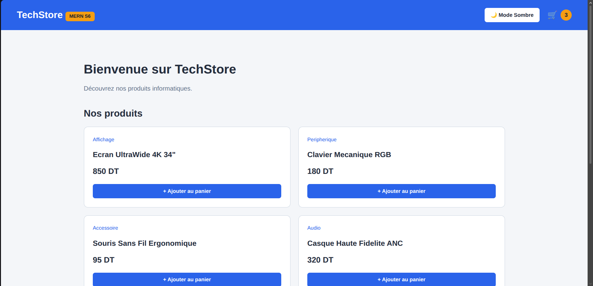
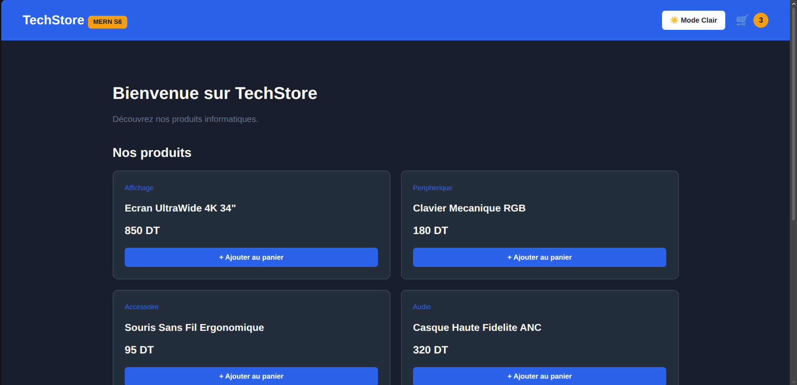
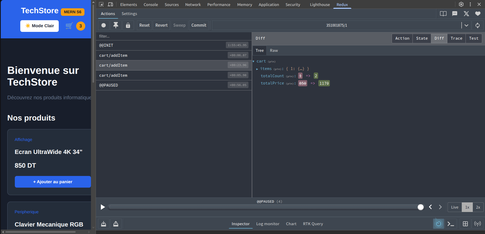

# 🛒 TechStore — React Global State with Redux Toolkit


> A React e-commerce lab solving **prop drilling** with a strict unidirectional data flow: theme toggle and shopping cart fully powered by **Redux Toolkit**, with `localStorage` persistence.

Built as part of the **MERN Stack course — Session 6: Global State Management (useContext → Redux Toolkit)** at École Polytechnique de Sousse.

---

## 📖 Overview

As a React app grows (navbar on top, catalog in the center, cart on the side), sharing state between distant components via props leads to the **prop drilling** anti-pattern. This project demonstrates the modern solution:

- A **single Redux store** holding two slices: `theme` (UI preference) and `cart` (transactional business state).
- A **strict one-way data flow**: `UI → dispatch(action) → reducer (Immer) → store → useSelector`.
- **Surgical re-renders**: components subscribe only to the exact state fraction they display.
- The theme was originally built with `useContext` and then **migrated to Redux Toolkit** — the migration is documented below.

## ✨ Features

- 🌗 **Light / Dark theme toggle** managed by a dedicated `themeSlice` (migrated from `useContext`)
- 🛒 **Reactive shopping cart**: add items, increment / decrement quantities, clear cart
- 🧮 **Live totals**: item count badge and total price (TND) recalculated on every mutation
- 💾 **Persistence**: theme and cart survive page reloads via `localStorage`
- 🎯 **Optimized rendering**: `useSelector` subscriptions — `ProductList` never re-renders when the cart changes
- 🔍 **Full traceability**: every mutation is inspectable in Redux DevTools (`cart/addItem`, `theme/toggleTheme`, …)
- 🪝 **Custom `useTheme()` hook** backed by Redux, preserving the old Context API signature

## 🖼️ Screenshots

| Light Mode | Dark Mode | Redux DevTools |
|---|---|---|
|  |  |  |

## 🧰 Tech Stack

| Technology | Role |
|---|---|
| **React 19** | UI library (function components + hooks) |
| **Redux Toolkit (RTK)** | Global state: `createSlice`, `configureStore`, Immer |
| **React Redux** | Bindings: `<Provider>`, `useSelector`, `useDispatch` |
| **Vite** | Dev server & build tool |
| **CSS (custom)** | Light / dark themes via `.app-wrapper.light` / `.app-wrapper.dark` |

## 🏗️ Architecture

### Unidirectional data flow

```
┌─────────────────┐   1. dispatch()   ┌──────────────────┐
│   UI Component  │ ────────────────► │   Action object  │
│ (Navbar, Cart…) │                   │ { type, payload }│
└─────────────────┘                   └────────┬─────────┘
        ▲                                      │ 2. (state, action)
        │ 4. useSelector()                     ▼
        │    (targeted re-render)     ┌──────────────────┐
┌───────┴─────────┐   3. new state    │  Slice reducer   │
│  Central Store  │ ◄──────────────── │  (Immer draft)   │
│ cart + theme    │                   └──────────────────┘
└─────────────────┘
```

> A UI component **never** mutates the store directly — it always dispatches an action.

### Global state shape

```js
{
  cart: {
    items: [{ id, name, price, category, quantity }],
    totalCount: 3,      // total units
    totalPrice: 1210    // total amount in TND
  },
  theme: {
    mode: 'light'       // 'light' | 'dark'
  }
}
```

## 📁 Project Structure

```
techstore-redux-toolkit/
├── docs/
│   └── screenshots/          # App captures (light, dark, DevTools)
├── src/
│   ├── components/
│   │   ├── Navbar.jsx        # Theme toggle + cart badge (useSelector × 2)
│   │   ├── ProductList.jsx   # Static catalog → dispatch(addItem(product))
│   │   └── Cart.jsx          # Cart rows, quantity controls, totals
│   ├── hooks/
│   │   └── useTheme.js       # Custom hook wrapping Redux (same API as Context)
│   ├── redux/
│   │   ├── store.js          # configureStore({ cart, theme })
│   │   ├── cartSlice.js      # addItem / removeItem / clearCart + totals
│   │   └── themeSlice.js     # toggleTheme / setTheme + persistence
│   ├── App.jsx               # Applies `app-wrapper ${theme}` class
│   ├── main.jsx              # Single <Provider store={store}>
│   └── index.css             # Light & dark theme styles
├── index.html
├── package.json
├── vite.config.js
└── README.md
```

## 🚀 Getting Started

### Prerequisites

- **Node.js** ≥ 20 (LTS recommended)
- **npm** ≥ 10
- *(Optional)* [Redux DevTools Extension](https://github.com/reduxjs/redux-devtools) for your browser

### Installation

```bash
# 1. Clone the repository
git clone https://github.com/bahaeddine-krifa/techstore-redux-toolkit.git
cd techstore-redux-toolkit

# 2. Install dependencies
npm install

# 3. Start the dev server
npm run dev
```

The app runs at **http://localhost:5173**.

### Available Scripts

| Command | Description |
|---|---|
| `npm run dev` | Start Vite dev server with HMR |
| `npm run build` | Production build into `dist/` |
| `npm run preview` | Preview the production build locally |
| `npm run lint` | Run ESLint |

## 🔍 State Management in Detail

### Action reference

| Action creator | Dispatched type | Payload | Effect |
|---|---|---|---|
| `toggleTheme()` | `theme/toggleTheme` | — | Flips `light ↔ dark`, persists to `localStorage` |
| `setTheme(mode)` | `theme/setTheme` | `'light' \| 'dark'` | Forces a specific theme |
| `addItem(product)` | `cart/addItem` | Product object | Increments quantity or adds a new row, recalculates totals |
| `removeItem(id)` | `cart/removeItem` | Product id | Decrements quantity, removes the row at 0 |
| `clearCart()` | `cart/clearCart` | — | Empties the cart and resets totals |

### Reading state — `useSelector`

```jsx
// Surgical subscriptions: each component re-renders only when its slice changes
const theme      = useSelector((state) => state.theme.mode);
const totalCount = useSelector((state) => state.cart.totalCount);
```

### Writing state — `useDispatch`

```jsx
const dispatch = useDispatch();

// ✅ Always wrap the action creator in an arrow function
<button onClick={() => dispatch(addItem(product))}>+ Add</button>
<button onClick={() => dispatch(toggleTheme())}>Toggle theme</button>
```

### Immutability with Immer

Inside reducers, "mutations" are written naturally — Immer produces an immutable snapshot behind the scenes:

```js
addItem: (state, action) => {
  const existing = state.items.find((item) => item.id === action.payload.id);
  if (existing) {
    existing.quantity += 1;              // looks mutable, stays immutable
  } else {
    state.items.push({ ...action.payload, quantity: 1 });
  }
  recalculateTotals(state);
}
```

## 💾 Persistence

| Key | Content | Restored on |
|---|---|---|
| `app_theme` | `'light'` or `'dark'` | App load (`themeSlice` initial state) |
| `techstore_cart` | JSON array of cart items | App load (`cartSlice` initial state, totals recalculated) |

Reload the page (**F5**) — the theme and the cart (items, badge, total) remain intact.

## 🔄 Migration: `useContext` → Redux Toolkit

The theme was first implemented with the native Context API, then refactored into a Redux slice **without any visible behavior change**.

| Before (Context) | After (RTK) |
|---|---|
| `createContext(null)` | `createSlice({ name: 'theme', … })` |
| `<ThemeProvider>` in `main.jsx` | ❌ Removed — the Redux `<Provider>` is enough |
| `useState` + `useEffect` in the Provider | `initialState` + `toggleTheme` reducer |
| `useContext(ThemeContext)` | `useSelector` + `useDispatch` |

**Why migrate the theme too?**

1. **Targeted re-renders** — Context re-renders *all* consumers on any change; `useSelector` only re-renders components subscribed to `state.theme.mode`.
2. **Traceability** — every toggle appears in DevTools as `theme/toggleTheme` with a state diff.
3. **Unified architecture** — one Provider, one store, zero `context/` files.

### Choosing the right tool (decision tree)

| Question | Tool |
|---|---|
| Used by a single component? | `useState` (local state) |
| Shared but rarely changing (theme, locale, auth)? | `useContext` |
| Frequent mutations, complex business state, strict standard + DevTools? | **Redux Toolkit** |
| Lightweight agile dashboard? | Zustand / Jotai |

## 🧪 Manual Test Scenario

1. Run `npm run dev` — the app opens in light mode with an empty cart.
2. Click **+ Add** once on the *UltraWide 4K Monitor 34"* (850 TND).
3. Click **+ Add** twice on the *RGB Mechanical Keyboard* (180 TND).
4. ✅ Navbar badge shows **3** — cart total shows **1210 TND** — `items` contains **2 distinct rows**.
5. Toggle **Dark Mode** — the palette switches instantly, cart content is preserved.
6. Press **F5** — theme and cart are restored from `localStorage`.
7. Open **Redux DevTools → Diff** — inspect `cart/addItem` and `theme/toggleTheme`.

## 🛠️ Troubleshooting

| Console error | Cause | Fix |
|---|---|---|
| `could not find react-redux context value` | `useSelector` / `useDispatch` called outside `<Provider>` | Wrap `<App />` with `<Provider store={store}>` in `main.jsx` |
| `Too many re-renders` | `onClick={dispatch(addItem(p))}` executes during render | Use an arrow function: `onClick={() => dispatch(addItem(p))}` |
| `Cannot assign to read only property` | Mutating state read via `useSelector` | Never mutate in components — dispatch an action |
| Action has no effect | `addItem(p)` called without `dispatch()` | Action creators only return `{ type, payload }` — always wrap in `dispatch()` |

## 🗺️ Roadmap

- [x] Theme slice migrated from `useContext` to RTK
- [x] Cart slice with live totals
- [x] `localStorage` persistence (theme + cart)
- [ ] Promo code engine (`POLY2027` → 20% discount)
- [ ] `uiSlice` + toast notifications (3s auto-hide)
- [ ] Multi-page navigation with React Router (Session 7)

## 🌿 Git Workflow

This repository follows the [Conventional Commits](https://www.conventionalcommits.org/) specification:

```
feat:     new feature
refactor: architectural change, same behavior
style:    CSS / formatting
chore:    tooling & config
docs:     documentation
```

Example history:

```
chore: initialize Vite + React project
feat: add static UI layout (Navbar, ProductList, Cart)
feat: create cart slice with addItem, removeItem and clearCart reducers
feat: configure Redux store and wrap app with Provider
refactor: migrate theme state from useContext to Redux Toolkit
feat: persist cart and theme state in localStorage
docs: add README with setup and usage instructions
```

## 🎓 Course Context

- **Course:** MERN Stack — Session 6: Global State Management (`useContext` & Redux Toolkit)
- **Instructor:** Dr. Abdelweheb GUEDDES
- **Institution:** École Polytechnique de Sousse — 2026–2027
- **Learning goals:** prop drilling, state scope, Context API, unidirectional flow, slices & Immer, surgical selectors, DevTools debugging
